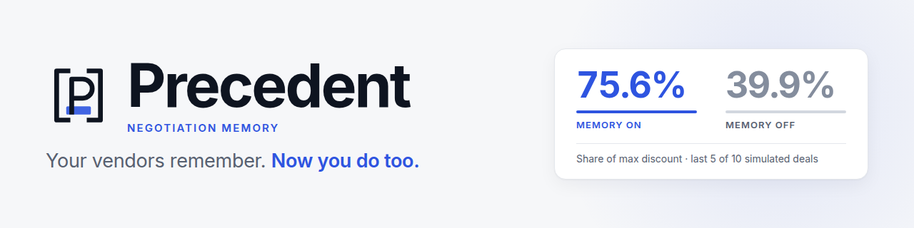
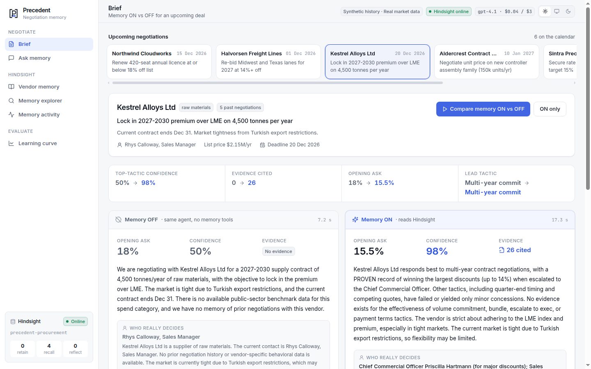

# Precedent

A buyer-side procurement-negotiation agent that remembers every vendor interaction in Hindsight and gets measurably better at each vendor over time.



*Same agent, same model, same prompt, live output. Left: memory OFF, no evidence. Right: memory ON, every claim cites a Hindsight memory and the real approver is named.*

## The problem

What a procurement team knows about a vendor lives in people's heads and inboxes: which tactic made the account manager fold, who really approves discounts, that the "48-hour special" is theatre, that the vendor was acquired and the old decision maker is gone. When a buyer changes jobs, that knowledge leaves with them, and the next negotiation starts from the list price again.

Precedent keeps that knowledge in a persistent memory, scoped per vendor. Before a negotiation it produces a brief: a ranked list of tactics, an opening ask, the likely real decision maker and watch-outs, each claim citing the memory it came from. After the negotiation, you log the outcome and the memory updates.

## How Hindsight memory is used

Precedent uses [Hindsight](https://github.com/vectorize-io/hindsight) (open source, from Vectorize) as its only memory store, running as a local server on port 8888. One bank holds everything; vendors are separated by tags, not by separate banks. The wrapper is `app/memory.py`.

| Hindsight feature | Where in the code | What it does for the agent |
|---|---|---|
| Bank missions (`retain_mission`, `observations_mission`, `reflect_mission`) | `memory.ensure_bank`, constants `RETAIN_MISSION`, `OBSERVATIONS_MISSION` | Steers extraction toward negotiation facts: tactic used, ask vs. result, who approved, timing habits, changes over time. Tells consolidation to record changes instead of discarding history. |
| Retain with per-vendor tags | `memory.retain_episode`, `memory.vtag` | Every episode is stored as text with tags `vendor:<id>` and `category:<category>`, the episode date as timestamp, and a stable `document_id` (`ep-<vendor>-<date>-<tactic>`) so re-seeding is idempotent. |
| Recall scoped by tag | `memory.recall_vendor` | `tags=["vendor:<id>"]`, `tags_match="any_strict"`, so a brief about one vendor can never pull another vendor's notes. Searches observations, world facts and experiences together. |
| Observations (consolidation) | `memory.vendor_memory_view`, `OBSERVATIONS_MISSION` | Hindsight consolidates raw facts into durable beliefs about a vendor and updates them as evidence arrives. The dashboard shows each observation with its proof count (number of source facts). |
| Mental model, one playbook per vendor | `memory.ensure_playbook`, `memory.playbook` | A standing summary (`playbook-<vendor_id>`, source query `PLAYBOOK_QUERY`, tagged to the vendor) created with `refresh_after_consolidation: True`, so Hindsight rewrites it after consolidation without Precedent re-asking. The agent reads it with `get_playbook`. |
| Reflect, used sparingly | `memory.reflect_vendor`, tool `reflect_on_vendor` in `app/agent.py` | Cross-memory reasoning at `budget="low"`. The system prompt limits it to one call per brief, only when recall and the playbook leave a gap. |
| Directives (standing rules in the bank) | `memory.DIRECTIVES`, `memory.ensure_directives`, `GET /api/directives` | Four rules stored in Hindsight, not only in our prompt: evidence before advice, respect what backfired, newest evidence wins, never under-ask. Hindsight applies them whenever it reasons (reflect, playbook refreshes). |
| Mental-model history | `memory.playbook_history`, `GET /api/memory/{id}/playbook/history` | Hindsight keeps every earlier version of a playbook and the memories each version was built from. The Vendor memory screen shows the versions and a diff, so you can see a playbook change after new outcomes arrive. |
| Recall trace, entities, time travel | `memory.explore_recall`, `POST /api/memory/recall` | The Memory explorer runs recall with `trace=True` and `include_entities=True` and shows which retrieval channel found each memory (semantic, keyword, graph, temporal), its rerank position, and the people and companies involved. An "as of" date limits results to what had happened by then: TransPacific's approver as of July 2025 was the Commercial Lead, and it is now the CFO. |
| Operation ledger | `memory._Tracked`, `GET /api/ledger` | Every Hindsight call the app makes is timed and recorded (operation, vendor, latency, success or error) and shown on the Memory activity screen. |

**Evolving beliefs.** The seeded history contains deliberate contradictions (see `data/generate.py`). For example, Northwind Cloudworks's discounts were approved by Raj Menon, the Regional Sales Director, through early 2026; a May 2026 episode records that Northwind was acquired by Stratus Group, Raj left, and a new VP Revenue Operations (Alan Pierce) now signs discounts. The observation and playbook for that vendor are meant to reflect the newer fact while keeping the earlier history, which is what `OBSERVATIONS_MISSION` asks for. Whether a given consolidation run phrases this well depends on the Hindsight model; inspect it in the Vendor memory tab.

**Structured metadata.** `memory.retain_episode` also attaches `tactic`, `outcome`, `final_discount`, `ask_discount` and `date` as metadata. Hindsight returns that metadata on every recalled fact, and facts from one episode share a `document_id`, so `memory.tactic_scoreboard` can de-duplicate and count outcomes exactly instead of asking an LLM to count.

**Outcomes feed back.** `POST /api/outcome` calls `memory.retain_episode`; the next brief can recall it, and consolidation then updates the observations and playbook.

## Agent design

`app/agent.py`, function `make_brief`, is a tool-calling loop over an Azure OpenAI chat-completions endpoint (`app/llm.py`, `chat_message`, with retry/backoff on 429/5xx and dropped connections).

- **Tools.** Memory tools: `tactic_scoreboard()` (tries, outcomes and best discount per tactic for this vendor, aggregated from the structured metadata on recalled memories, plus the tactics still untried), `recall_memory(query)`, `get_playbook()`, `reflect_on_vendor(question)`. Base tools: `market_benchmarks()` (real award statistics for the vendor's category) and `submit_brief(...)`, which validates that tactics come from the fixed list of seven (`competing_quote`, `volume_commit`, `multi_year`, `quarter_end_timing`, `bundle`, `escalate_to_exec`, `payment_terms`) and that the ask is numeric.
- **Fair memory ON/OFF comparison.** Memory OFF removes only the four memory tools. Same model, system prompt, loop, step limit (7) and base tools. The user message differs by one sentence ("Memory tools are available." vs. "You have no memory of past dealings.").
- **Citations.** Every recall, playbook or reflect result is registered in a per-run evidence list with ids `m1`, `m2`, ... The model must cite them inside each tactic's `why`. The API returns `citations` (id, text, kind, date) and a `trace` of every tool call (truncated results), shown in the dashboard.
- **Learning policy** (in the `SYSTEM` prompt). Every negotiation is treated as an experiment: a tactic the scoreboard marks PROVEN (it has won) is ranked first; a tactic that was lost or made the vendor harden is not ranked first again; if nothing has proven itself, the agent ranks an untried tactic that fits the vendor and says it is an experiment. **Opening ask:** about 10% above the best discount a proven tactic achieved, otherwise 18% off list, and never lower, because an under-ask makes a good tactic look like it failed. (An earlier version anchored the ask to the best discount seen so far and spiralled down; see the evaluation notes below.) With no evidence the agent must say "unknown" and use low confidence.
- **Failure handling.** Tool errors are returned to the model; on the last step the model is told to submit; if no brief is produced a low-confidence fallback is returned.

## Chat and search

The **Chat** tab (`app/chat.py`, `POST /api/chat`) lets a buyer ask questions across the whole vendor memory in plain language, for example "Which vendors changed owner or contact recently?" or "Which tactic has backfired most often, and with whom?". It is a second tool-calling agent over the same Hindsight bank:

- `search_memory(query, vendor?)` searches every vendor, or one. `search_each_vendor(query)` runs the same search inside each vendor so a "which vendors..." question cannot miss one.
- `cross_vendor_stats()` returns exact win, partial and loss counts per tactic with the vendors involved, computed from the structured metadata. Counting questions use this tool instead of an LLM's estimate.
- `vendor_scoreboard`, `vendor_playbook`, `list_vendors` and `market_benchmarks` cover the rest.
- Answers cite their evidence (`[m3]` chips that open the source memory) and show the tool trace. The assistant is told to say "in the memories I found" unless a sweep covered every vendor, and to say so plainly when memory has nothing. A **Memory ON/OFF toggle** (like the Brief screen) switches the chat agent between all tools and only `list_vendors` and `market_benchmarks`, with the same model, loop and step limit; with memory OFF it still helps (general procurement guidance, the vendor list and market benchmarks) but says plainly that it has no record of past dealings and never invents facts about a vendor, and each answer is badged with the mode it ran in. The conversation is kept client-side and the last 8 messages are sent each turn. A vendor can be pinned as the scope. The same spend guard applies.

## Learning-curve evaluation

`POST /api/eval/run` (`app/main.py`, `_eval_loop`) runs a closed-loop simulation using `app/sim.py`.

- **Hidden vendor profiles.** Each of the 12 vendors in `data/vendors.json` carries a `hidden` profile: `floor_discount` (the most they will ever give), the tactic that works, the tactic that backfires, the real decision maker, and a quirk. The simulator reads it; the agent never does, and `GET /api/vendors` strips it (`public()` in `app/main.py`).
- **Cold start.** Each eval job creates a fresh, empty Hindsight bank (`precedent-eval-<job_id>`). The agent knows nothing at episode 1.
- **Two arms per vendor and episode.** The same objective is given to a memory-ON agent and a memory-OFF baseline. Each takes its top-ranked tactic and opening ask, and `sim.respond` returns the discount, outcome and notes. Only the memory arm's result is retained into the bank (with the playbook ensured first), so memory-ON can learn from earlier episodes and the baseline cannot.
- **Metric.** `savings_pct` = achieved discount as a percentage of the vendor's hidden `floor_discount` (capped at 100), averaged across vendors for each episode index. `won` counts episodes where the discount reached at least 85% of the floor. The two series are plotted memory vs. baseline in the Learning curve tab.
- **Parameters.** `episodes` and `vendors` (the first N vendors in `vendors.json`); the request defaults are 10 and 3. Results are checkpointed to `data/eval_partial.json` and the finished run is cached in `data/eval_cache.json`.

### Result (one run, 3 simulated vendors x 10 negotiations, cold start)

| Negotiation # | 1 | 2 | 3 | 4 | 5 | 6 | 7 | 8 | 9 | 10 |
|---|---|---|---|---|---|---|---|---|---|---|
| **Memory ON** (% of vendor's best possible discount) | 44.0 | 68.6 | 74.5 | 78.2 | 71.8 | 75.2 | 68.4 | 78.0 | 80.2 | 76.2 |
| **Memory OFF** | 40.5 | 41.9 | 45.7 | 36.3 | 37.5 | 40.4 | 30.0 | 46.4 | 38.1 | 44.5 |
| Wins, ON / OFF (of 3 vendors) | 0 / 0 | 1 / 0 | 1 / 0 | 2 / 0 | 2 / 0 | 2 / 0 | 2 / 0 | 2 / 0 | 2 / 0 | 2 / 0 |

Averaged over the last five negotiations: **75.6% with memory vs 39.9% without**. A "win" means at least 85% of the
vendor's maximum possible discount. Both agents start equal; the memory agent finds each vendor's working tactic and
stops repeating the one that backfires. The baseline never wins.

**How to read this honestly**
- It is a simulator I wrote, with hidden per-vendor profiles. It shows the mechanism works, not real-world savings.
- One run, three vendors, no confidence intervals. The third vendor was never solved in ten negotiations.
- The result depends on three things working together: Hindsight recall with structured metadata (the
  `tactic_scoreboard` tool), a prompt that tells the agent to exploit proven tactics and explore untried ones, and an
  ask rule (open at 18% when nothing is proven, ~10% above the best result when something is). The 18% / +10% numbers
  are my procurement-convention heuristic, not something the agent learns.
- An earlier version of the prompt told the agent to anchor its ask near the best discount seen so far. That caused a
  death spiral (low ask, low result, even lower ask) and memory-ON scored no better than baseline. Fixing it was
  what made the curve climb. The model cost of this evaluation run was about $1.
- The cached run is in `data/eval_cache.json`; the dashboard replays it for free. A fresh run needs `ALLOW_FRESH_EVAL=1`.


The simulator is deterministic given the agent's choices (seeded RNG), but the LLM agent is not, so repeated runs vary.

## Band integration

`band_agents/` runs three deterministic (no LLM) agents on [Band](https://app.band.ai) in one room, all calling the Precedent API:

- **Scout**: `@Scout benchmarks for SaaS licences` returns real public-award statistics from `data/market_benchmarks.json`.
- **Negotiator**: `@Negotiator brief <vendor> [memory off]` calls `POST /api/brief` and posts the brief with its cited memories.
- **Ledger**: `@Ledger log <vendor> tactic=... ask=... got=... outcome=... <notes>` calls `POST /api/outcome`; `@Ledger memory <vendor>` shows the vendor's observations.

Logging an outcome through Ledger and then asking Negotiator for a new brief closes the loop inside the chat room. Setup is in `band_agents/README.md`; parsing and formatting logic is unit-tested offline (`uv run pytest` in `band_agents/`).

## Data: what is real and what is synthetic

**Real.** `data/market_benchmarks.json` is computed by `data/build_benchmarks.py` from the Estonian Public Procurement Register (open data, `datahub.io/nimistu/estonia-public-procurement`, 19,133 awards). For five spend categories, mapped from CPV divisions, it holds award-size quartiles (EUR), average bidder counts, single-bidder share and negotiated-procedure share. The agent's `market_benchmarks` tool and Scout use it.

**Synthetic.** The 12 vendors, their 61 negotiation episodes (`data/history.json`) and 6 upcoming negotiations (`data/upcoming.json`) are fictional, hand-authored in `data/generate.py` and validated by it. The vendor names are invented.

**Why.** No public dataset contains negotiation notes: who said what on a call, which tactic worked. Writing such notes about real firms would be fabrication and could defame them. So the notes are written about fictional vendors, consistent with hidden profiles (they are how the agent can infer behaviour, but never state it outright), with a few deliberate contradictions over time. The benchmarks are the only real-world numbers and are labelled as such.

## Architecture

```
 frontend/ -> web/dist (React UI)      band_agents/ (Scout, Negotiator, Ledger)
          \                                   /
           +------------- HTTP ---------------+
                          |
                FastAPI  app/main.py  (:8000)
        /api/brief  /api/outcome  /api/memory  /api/eval
              |                          |
      app/agent.py  tool loop      app/sim.py (hidden profiles)
        |         \                      |
 app/llm.py     app/memory.py ----> Hindsight server (:8888)
 gpt-4.1        (hindsight_client)    bank, observations, mental models
 (Azure)                                 |
                                   gpt-4.1-mini (Azure): extraction, consolidation
```

More detail, with Mermaid diagrams and sequence flows, is in [docs/architecture.md](docs/architecture.md).

## Quickstart

Requires Python 3.12+ and [uv](https://docs.astral.sh/uv/).

```bash
uv sync
cp .env.example .env        # fill in the Azure OpenAI variables
./run_hindsight.sh          # Hindsight server on :8888 (leave running)
uv run python scripts/seed.py   # creates the bank, one playbook per vendor, retains 61 episodes
./run_api.sh                # API + dashboard on :8000
```

Then open http://localhost:8000. The dashboard is a React app (`frontend/`, React + Vite + TypeScript + Tailwind) whose production build is committed in `web/dist`, so Node is not needed to run it. To change the UI, run `cd frontend && npm install && npm run dev` (port 5173, proxies `/api` to :8000) and `npm run build` to refresh `web/dist`. Add `?mock=1` to the URL to explore every screen on recorded fixtures without calling the LLM. The original single-file dashboard is still served at `/legacy`.

To run the offline tests (no LLM or network calls): `uv run pytest -q`.

Seeding makes one retain call per episode and Hindsight does LLM extraction for each, so it takes a while. `run_api.sh` and `run_hindsight.sh` call binaries in `.venv/bin`, so run `uv sync` first.

## Configuration

Two separate models, both Azure OpenAI deployments (v1 endpoint), set in `.env`:

- `LLM_MODEL`, `LLM_BASE_URL`, `LLM_API_KEY`: the agent, **gpt-4.1**. It drives the tool loop and writes the brief, where reasoning quality and reliable tool calling matter.
- `HINDSIGHT_API_LLM_*`: Hindsight's background work, **gpt-4.1-mini**: fact extraction on retain, observation consolidation, mental-model refresh. It runs on every retained episode and every consolidation, so a cheaper, faster model keeps seeding and the eval affordable. `HINDSIGHT_API_LLM_MAX_CONCURRENT` and `_MAX_RETRIES` help with rate limits.
- `HINDSIGHT_URL`, `HINDSIGHT_BANK_ID`: where the server is and which bank the app uses (default `precedent-procurement`).

`run_hindsight.sh` loads `.env` into the server's environment. Keep `.env` out of version control.

## Team

| | Role | GitHub |
|---|---|---|
| **Nandhini Selvam** | Team Lead, Solution Architect | [@NandhiniSelvam4](https://github.com/NandhiniSelvam4) |
| **Ranjith Kumar G** | Senior AI Engineer | [@ranjith-kumar-28100](https://github.com/ranjith-kumar-28100) |

## Limitations and roadmap

- The negotiation notes are synthetic, and the simulator is a simple model of vendor behaviour (one tactic works, one backfires, the rest give partial concessions). Learning-curve gains show the memory loop works under that model, not that real vendors behave this way.
- The agent LLM is non-deterministic; single eval runs are noisy.
- Outcomes are entered by hand or via Band; there is no ingestion yet.
- Chat answers depend on what is retained; a search can miss a memory, so non-exhaustive answers are labelled as such. Vendors and negotiations are loaded from JSON files at startup; there is no add/remove-vendor UI or memory-editing yet.
- No authentication. The API has open CORS and is meant for local use.
- Roadmap: ingest real history from email, CRM and contract repositories; ERP and spend-data integrations; one bank per tenant for multi-team use; use Hindsight's memory-defense feature to keep personal data (contact names, emails) out of long-term memory where it is not needed.
