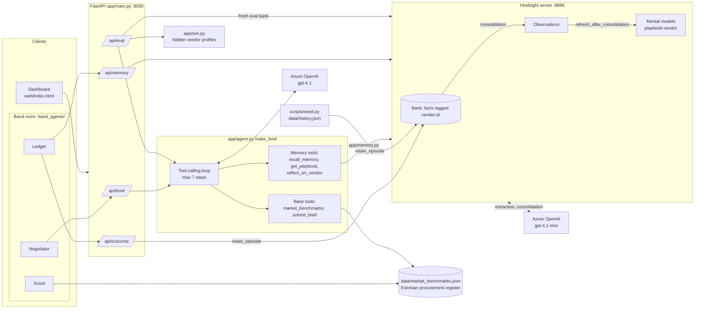
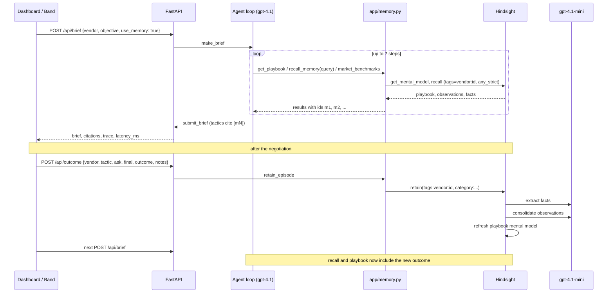

# Architecture

## System

## One memory-ON brief, then outcome logging

## Evaluation loop

For each episode and vendor, `_eval_loop` in `app/main.py` runs the memory-ON and memory-OFF agents against a fresh bank, applies each arm's top tactic and ask through `sim.respond` (using the hidden profile), records `savings_pct` (discount / hidden floor), and retains only the memory arm's outcome so later episodes can use it.
